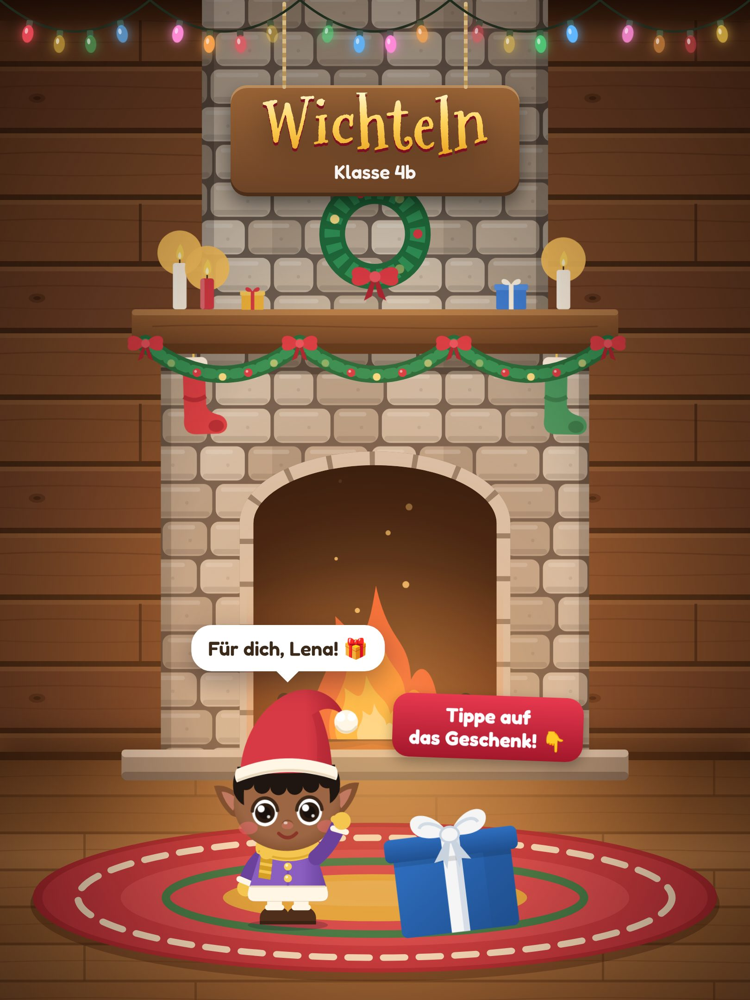
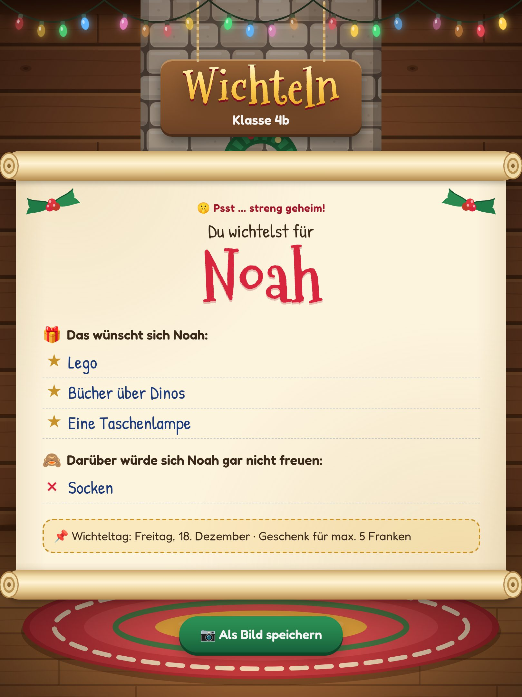

# 🎄 Wichteln: die magische Wichtel-Auslosung für die Klasse

Die Kinder schreiben ihren **Wunschzettel auf dem Tablet**. Am **Beamer** holen kleine Wichtel die eingepackten Zettel ab und bringen jedem Kind geheim auf sein Tablet, **für wen es wichtelt**, zusammen mit den Wünschen dieser Person.


| Wunschzettel schreiben | Der Wichtel kommt | Der geheime Wichtelzettel |
| --- | --- | --- |
|  |  |  |

## So läuft es im Unterricht

1. **Runde erstellen:** Startseite öffnen → Klassenname und Namen der Kinder eintragen (ein Name pro Zeile) → *Wichtelrunde erstellen*. Optional kommt ein **Hinweis für alle** dazu (z. B. „Wichteltag: Freitag, 18. Dezember · max. 5 Franken“). Er steht später auf jedem Zettel.
2. **Am Beamer zeigen:** Es erscheint eine verschneite Winterlandschaft mit Tannenbaum, Lichterkette und einem **QR-Code**. Für jedes Kind steht ein Namensschild im Schnee.
3. **Kinder scannen den QR-Code** mit dem Tablet (oder geben den 5-stelligen Code auf der Startseite ein), tippen auf ihren Namen und bestätigen „Ja, das bin ich!“.
4. **Wunschzettel schreiben:** Eine Schriftrolle rollt sich auf. Oben steht *Das wünsche ich mir*, unten *Darüber würde ich mich gar nicht freuen*. Alles wird automatisch gespeichert.
5. **Fertig!** Die Rolle wird zusammengerollt, mit einer Schleife verschnürt, in ein Geschenk gepackt und fliegt davon. Am Beamer fällt das Geschenk beim Namensschild in den Schnee. ✨
6. Sind alle Zettel eingepackt, pulsiert am Beamer der Knopf **„🎅 Wichtel losschicken!“**. Ein Klick darauf, und ganz viele Wichtel marschieren durchs Bild, holen die Geschenke ab und laufen davon (mit „Jingle Bells“, wenn der Ton an ist).
7. **Auf den Tablets** kommt danach ein Wichtel mit einem Geschenk hereingelaufen: „Für dich, Lena!“. Das Kind tippt auf das Geschenk, der Deckel springt auf, die Rolle steigt heraus und rollt sich auf: **„Du wichtelst für … Max“** mit allen Wünschen und No-Gos von Max.
8. Mit **📷 Als Bild speichern** landet der Zettel als Bild in der Galerie (iPad/Android: im Teilen-Menü „Bild sichern“ wählen).

Am Beamer sieht man nur, *dass* die Wichtel unterwegs sind, nie, wer für wen wichtelt. Danach zeigt ein Häkchen am Namensschild, wer seinen Zettel schon geöffnet hat.

### Gut zu wissen

- **⚙️ Verwaltung** (oben rechts am Beamer): Namen ändern (auf den Namen tippen), Kinder hinzufügen oder entfernen, Hinweis ändern, Links kopieren.
- **🔓 Tablet freigeben:** Jeder Name kann nur auf *einem* Tablet gewählt werden, damit niemand bei anderen spicken kann. Hat ein Kind aus Versehen den falschen Namen erwischt oder das Gerät gewechselt, gibst du den Namen in der Verwaltung frei.
- **Teilen sich zwei Kinder ein Tablet?** Kein Problem: Oben rechts gibt es „Nicht du? Name wechseln“.
- **Fehlt ein Kind?** Du kannst trotzdem auslosen. Das Kind schreibt seinen Wunschzettel später und bekommt seinen Wichtelzettel dann sofort. Wer für dieses Kind wichtelt, sieht die Wünsche, sobald sie geschrieben sind (die Seite aktualisiert sich von selbst).
- **Auslosung:** Alle Kinder bilden einen grossen Kreis (A → B → C → … → A). Niemand zieht sich selbst und es gibt keine Paare, die sich gegenseitig beschenken. Mindestens 3 Kinder.
- **📄 Wichtelkarten zum Ausdrucken:** Nach der Auslosung kannst du in der Verwaltung ein PDF speichern. Pro Kind gibt es ein Blatt: **vorne** steht gross der Name des Kindes, **hinten** geheim, für wen es wichtelt, mit Wünschen, No-Gos und deinem Hinweis. **Beidseitig drucken** (an der langen Kante wenden). Vergisst ein Kind, für wen es wichtelt, suchst du sein Blatt anhand des Namens und gibst es ihm, ohne die Rückseite selbst anzuschauen. Die Blätter sind alphabetisch sortiert. Schreibt ein Kind seinen Wunschzettel erst später, speicherst du das PDF einfach nochmal.
- **Ein Kind hat vergessen, für wen es wichtelt?** Es öffnet die Seite einfach nochmal auf seinem Tablet. Oder es bekommt seine Wichtelkarte (siehe oben). Am Bildschirm siehst du die Liste unter *🔒 Zuteilung anzeigen* (nicht am Beamer!).
- **Lehrer-Link:** Nur wer den geheimen Lehrer-Link hat, kann die Runde verwalten und die Wichtel losschicken. Auf dem Gerät, auf dem du die Runde erstellt hast, findest du sie unter *Deine Wichtelrunden* auf der Startseite. Für ein anderes Gerät (z. B. den Beamer-Computer) kopierst du den Lehrer-Link in der Verwaltung.

---

## Online stellen bei Infomaniak (normale PHP-Website)

Das Tool ist eine ganz normale **PHP-Website** (PHP 8). Es braucht **keine Datenbank** und kein Node.js: Die Wichtelrunden werden als geschützte Dateien im Ordner `data` gespeichert. Es läuft also in jedem Infomaniak-Webhosting, wie deine anderen Websites.

### 1. Website anlegen

1. Im [Infomaniak-Manager](https://manager.infomaniak.com) **Web & Domains** öffnen.
2. Rechts in der Zeile deines Webhostings auf **⋮** klicken → **Website hinzufügen**.
3. Eine normale Website (PHP) **ohne** Vorlage/CMS wählen.
4. Als Adresse eine **Subdomain** wählen, z. B. `wichteln.deinedomain.ch`. ⚠️ Nicht die Hauptdomain.
5. **SSL (https)** für die Subdomain aktivieren, falls das nicht automatisch passiert.

### 2. Dateien hochladen

1. Die Datei **`Wichteln-Website.zip`** bereithalten (siehe unten, wie du sie bekommst).
2. Im Manager dein Webhosting öffnen → links **FTP / SSH** → **Web FTP**.
3. In den Ordner **`sites/wichteln.deinedomain.ch`** wechseln. Liegt dort schon eine `index.html` von Infomaniak, diese löschen.
4. Die ZIP-Datei in den Ordner ziehen (hochladen), dann **Rechtsklick → Entpacken** und die ZIP-Datei danach löschen.
5. Kontrolle: Direkt im Ordner müssen jetzt u. a. `index.html`, `api.php`, `.htaccess` sowie die Ordner `js`, `css`, `lib` und `data` liegen (nicht in einem Unterordner).
6. `https://wichteln.deinedomain.ch` öffnen. Fertig! 🎄

**So bekommst du die ZIP-Datei:** Wer Git und Node.js hat, führt `npm run zip` aus (die Datei landet in `dist/`). Ohne das: auf GitHub *Code → Download ZIP*, entpacken, den Ordner **`web`** öffnen, alles darin markieren → „In ZIP-Datei komprimieren“.

### Alternative: mit einem Befehl über die SSH-Konsole

Wenn du bei Infomaniak eine SSH-Konsole öffnen kannst, geht Installieren und Aktualisieren auch ohne ZIP (Ordner ggf. anpassen):

```bash
cd ~/sites/wichteln.deinedomain.ch && curl -fsSL https://raw.githubusercontent.com/fabulousteaching/Wichteln/main/scripts/update.sh | bash -s -- --install
```

Für spätere **Updates** denselben Befehl ohne `-s -- --install`:

```bash
cd ~/sites/wichteln.deinedomain.ch && curl -fsSL https://raw.githubusercontent.com/fabulousteaching/Wichteln/main/scripts/update.sh | bash
```

Die Wichtelrunden (Ordner `data`) und deine Einstellungen (`config.php`) bleiben dabei erhalten. Das Repository muss dafür öffentlich sein.

Ohne SSH aktualisierst du per ZIP wie oben, lässt dabei aber den Ordner `data` und die Datei `config.php` auf dem Server stehen.

### Automatisch veröffentlichen (GitHub → Infomaniak)

Ist das einmal eingerichtet, kommt jede Änderung auf `main` nach etwa einer Minute von selbst auf die Website. Vorher laufen die Tests; schlagen sie fehl, wird nichts hochgeladen. Gespeicherte Wichtelrunden (`data`) und `config.php` auf dem Server werden nie angefasst.

**1. FTP-Zugang bei Infomaniak**
1. Im Manager dein Webhosting öffnen → links **FTP / SSH**.
2. Dort steht die **FTP-Serveradresse** (z. B. `xxxx.ftp.infomaniak.com`).
3. Ein **neues FTP-Konto** anlegen, z. B. `wichteln-github`, mit einem langen Passwort. Benutzername und Passwort notieren.
   Tipp: Wenn du das Konto auf den Ordner `sites/wichteln.deinedomain.ch` beschränken kannst, ist das noch sicherer. Dann zusätzlich die Variable `FTP_DIR` mit dem Wert `./` anlegen (siehe unten).

**2. Zugangsdaten auf GitHub hinterlegen**
1. Auf GitHub im Repository **Settings → Secrets and variables → Actions** öffnen.
2. Unter **Secrets** mit **New repository secret** drei Einträge anlegen:
   - `FTP_SERVER`: die Serveradresse aus Schritt 1
   - `FTP_USERNAME`: der FTP-Benutzername
   - `FTP_PASSWORD`: das FTP-Passwort
3. Nur falls deine Website **nicht** `wichteln.fabulousteaching.ch` heisst: unter **Variables** eine Variable `FTP_DIR` anlegen, z. B. `sites/wichteln.deinedomain.ch/`.

**3. Ausprobieren**
Auf GitHub **Actions → Website veröffentlichen → Run workflow** klicken. Nach etwa einer Minute erscheint ein grüner Haken ✅. Bei einem roten Kreuz auf den Lauf klicken und die Meldung lesen (oder mir schicken).

Die Secrets kann nach dem Speichern niemand mehr lesen, auch nicht auf GitHub selbst. Sie werden nur für das Hochladen verwendet.

### Einstellungen (optional)

Kopiere `config.example.php` auf dem Server zu **`config.php`** und passe die Werte an:

| Einstellung | Bedeutung |
| --- | --- |
| `teacher_password` | Wenn gesetzt, braucht es dieses Passwort, um **neue Runden zu erstellen**. Praktisch, weil die Adresse öffentlich ist. |
| `retention_days` | Nach wie vielen Tagen ohne Änderung eine Runde automatisch gelöscht wird (Standard `120`) |
| `public_url` | Feste Adresse für den QR-Code, z. B. `https://wichteln.deinedomain.ch` (normalerweise nicht nötig) |

---

## Datenschutz

- Gespeichert werden nur die **Vornamen**, die du eingibst, und die **Wunschzettel**. Keine E-Mail-Adressen, keine Konten, keine Tracker, keine externen Schriften oder Skripte.
- Die Daten liegen auf **deinem** Webhosting im Ordner `data`. Dieser Ordner ist für den Browser gesperrt, und jede Datei beginnt zusätzlich mit einer PHP-Sperre, sodass beim Aufruf nichts ausgegeben wird.
- Die Namensliste einer Runde sieht nur, wer den Code bzw. QR-Code kennt.
- Wer für wen wichtelt, sieht nur das jeweilige Kind auf seinem Tablet (und du über den Lehrer-Link).
- Runden lassen sich in der Verwaltung jederzeit **löschen** und werden nach 120 Tagen ohne Änderung automatisch gelöscht.

## Technik

- `web/`: alles, was auf den Server kommt. PHP 8 (`api.php` + `lib/wichtel.php`), keine Datenbank: eine JSON-Datei pro Runde mit Dateisperre und atomarem Speichern. `.htaccess` leitet `/lehrer/…`, `/k/…` und `/api/…` weiter und sperrt `lib` und `data`.
- Beamer und Tablets fragen alle 2–3 Sekunden mit einer winzigen Anfrage nach, ob sich etwas geändert hat (`/api/rounds/CODE/version`).
- Alle Bilder (Wichtel, Geschenke, Tannenbaum, Lichterkette) sind selbst gezeichnete SVGs, die Klänge werden im Browser erzeugt, der QR-Code ebenfalls ([qrcode-generator](https://github.com/kazuhikoarase/qrcode-generator), MIT). Schriften: Fredoka, Patrick Hand (SIL OFL) und Mountains of Christmas (Apache 2.0), lokal eingebunden.
- **Entwicklung** (braucht PHP und Node.js): `npm run dev` startet `http://localhost:8000`, `npm test` prüft Schnittstelle und Auslosung gegen den eingebauten PHP-Server.
