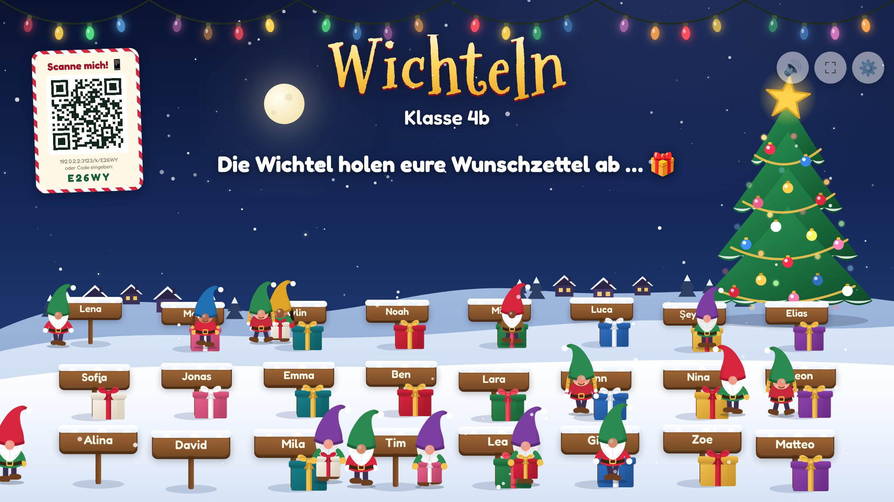
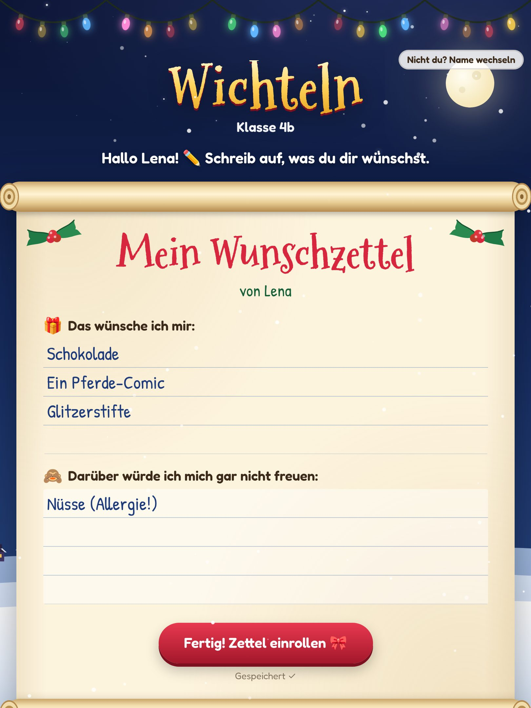

# 🎄 Wichteln: die magische Wichtel-Auslosung für die Klasse

Die Kinder schreiben ihren **Wunschzettel auf dem Tablet**. Am **Beamer** holen kleine Wichtel die eingepackten Zettel ab und bringen jedem Kind geheim auf sein Tablet, **für wen es wichtelt**, zusammen mit den Wünschen dieser Person.



| Wunschzettel schreiben | Der Wichtel kommt | Der geheime Wichtelzettel |
| --- | --- | --- |
|  |  |  |

## So läuft es im Unterricht

1. **Runde erstellen:** Startseite öffnen → Klassenname und Namen der Kinder eintragen (ein Name pro Zeile) → *Wichtelrunde erstellen*. Optional kommt ein **Hinweis für alle** dazu (z. B. „Wichteltag: Freitag, 18. Dezember · max. 5 Franken“). Er steht später auf jedem Zettel.
2. **Am Beamer zeigen:** Es erscheint eine verschneite Winterlandschaft mit Tannenbaum, Lichterkette und einem **QR-Code**. Für jedes Kind steht ein Namensschild im Schnee.
3. **Kinder scannen den QR-Code** mit dem Tablet (oder geben den 5-stelligen Code auf der Startseite ein), tippen auf ihren Namen und bestätigen „Ja, das bin ich!“.
4. **Wunschzettel schreiben:** Eine Schriftrolle rollt sich auf. Oben steht *Das wünsche ich mir*, unten *Darüber würde ich mich gar nicht freuen*. Alles wird automatisch gespeichert.
5. **Fertig!** Die Rolle wird zusammengerollt, mit einer Schleife verschnürt, in ein Geschenk gepackt und fliegt davon. Am Beamer fällt das Geschenk beim Namensschild in den Schnee. ✨
6. Sind alle Zettel eingepackt, pulsiert am Beamer der Knopf **„🎅 Wichtel losschicken!“**. Ein Klick darauf, und ganz viele Wichtel marschieren durchs Bild, holen die Geschenke ab und laufen davon (mit „Jingle Bells“, wenn der Ton an ist).
7. **Auf den Tablets** kommt danach ein Wichtel mit einem Geschenk hereingelaufen: „Für dich, Lena!“. Das Kind tippt auf das Geschenk, der Deckel springt auf, die Rolle steigt heraus und rollt sich auf: **„Du wichtelst für … Max“** mit allen Wünschen und No-Gos von Max.
8. Mit **📷 Als Bild speichern** landet der Zettel als Bild in der Galerie (iPad/Android: im Teilen-Menü „Bild sichern“ wählen).

Am Beamer sieht man nur, *dass* die Wichtel unterwegs sind, nie, wer für wen wichtelt. Danach zeigt ein Häkchen am Namensschild, wer seinen Zettel schon geöffnet hat.

### Gut zu wissen

- **⚙️ Verwaltung** (oben rechts am Beamer): Namen ändern (auf den Namen tippen), Kinder hinzufügen oder entfernen, Hinweis ändern, Links kopieren.
- **🔓 Tablet freigeben:** Jeder Name kann nur auf *einem* Tablet gewählt werden, damit niemand bei anderen spicken kann. Hat ein Kind aus Versehen den falschen Namen erwischt oder das Gerät gewechselt, gibst du den Namen in der Verwaltung frei.
- **Teilen sich zwei Kinder ein Tablet?** Kein Problem: Oben rechts gibt es „Nicht du? Name wechseln“.
- **Fehlt ein Kind?** Du kannst trotzdem auslosen. Das Kind schreibt seinen Wunschzettel später und bekommt seinen Wichtelzettel dann sofort. Wer für dieses Kind wichtelt, sieht die Wünsche, sobald sie geschrieben sind (die Seite aktualisiert sich von selbst).
- **Auslosung:** Alle Kinder bilden einen grossen Kreis (A → B → C → … → A). Niemand zieht sich selbst und es gibt keine Paare, die sich gegenseitig beschenken. Mindestens 3 Kinder.
- **Ein Kind hat vergessen, für wen es wichtelt?** Es öffnet die Seite einfach nochmal auf seinem Tablet. Oder du schaust in der Verwaltung unter *🔒 Zuteilung anzeigen* nach (nicht am Beamer!).
- **Lehrer-Link:** Nur wer den geheimen Lehrer-Link hat, kann die Runde verwalten und die Wichtel losschicken. Auf dem Gerät, auf dem du die Runde erstellt hast, findest du sie unter *Deine Wichtelrunden* auf der Startseite. Für ein anderes Gerät (z. B. den Beamer-Computer) kopierst du den Lehrer-Link in der Verwaltung.

---

## Starten auf dem eigenen Computer (kostenlos)

Voraussetzung: [Node.js](https://nodejs.org) **Version 22.13 oder neuer**.

```bash
cd wichtel
npm install
npm start
```

Im Fenster erscheinen zwei Adressen:

```
🎄 Wichtel-Tool läuft:  http://localhost:3000
   Im gleichen WLAN:     http://192.168.1.23:3000
```

Öffne die erste Adresse am Computer, der am Beamer hängt. Der QR-Code zeigt automatisch auf die WLAN-Adresse, damit die Tablets den Computer finden. **Computer und Tablets müssen im gleichen WLAN sein.** In manchen Schulnetzen sind Geräte voneinander abgeschirmt. Dann klappt es nur mit dem Online-Betrieb (siehe unten).

## Online bei Infomaniak (rund um die Uhr erreichbar)

So läuft das Tool auf deinem Infomaniak-Webhosting mit Node.js, genau wie die Instamatisierung:

1. Infomaniak-Manager → **Web & Domains → dein Webhosting → Website hinzufügen** → Technologie **Node.js**.
2. Webadresse: eine **Subdomain**, z. B. `wichteln.deinedomain.ch` (nicht die Hauptdomain, sonst wird deine Website ersetzt).
3. **Bestehendes Projekt importieren** → ZIP hochladen. Die ZIP erstellst du so: den Ordner `wichtel` öffnen, alles **ausser `node_modules` und `data`** markieren → „In ZIP-Datei komprimieren“.
4. **Build-Befehl:** `npm install` · **Ausführungsbefehl:** `npm start` · **Port:** `3000` → *Installation abschliessen*.
5. SSL-Zertifikat (https) für die Subdomain aktivieren. Danach ist das Tool unter `https://wichteln.deinedomain.ch` erreichbar.

**Aktualisieren:** Manager → deine Node.js-Website → **SSH-Konsole öffnen** und (Ordner ggf. anpassen):

```bash
cd ~/sites/wichteln.deinedomain.ch && curl -fsSL https://raw.githubusercontent.com/fabulousteaching/Instamatisierung/claude/wichtel-drawing-tool-uqunr4/wichtel/scripts/update.sh | bash
```

Danach im Manager auf **Neu starten** klicken. Die Wichtelrunden (Ordner `data`) bleiben erhalten.

### Einstellungen (optional)

Als Umgebungsvariablen beim Hoster oder in einer Datei `.env` setzen:

| Variable | Bedeutung |
| --- | --- |
| `PORT` | Port des Servers (Standard `3000`) |
| `TEACHER_PASSWORD` | Wenn gesetzt, braucht es dieses Passwort, um **neue Runden zu erstellen**. Praktisch, wenn die Adresse öffentlich ist. |
| `PUBLIC_URL` | Feste Adresse für den QR-Code, z. B. `https://wichteln.deinedomain.ch` (normalerweise nicht nötig) |
| `RETENTION_DAYS` | Nach wie vielen Tagen ohne Änderung eine Runde automatisch gelöscht wird (Standard `120`) |
| `DATABASE_PATH` | Speicherort der Datenbank (Standard `data/wichtel.db`) |

Mit Docker: `docker build -t wichtel . && docker run -p 3000:3000 -v wichtel-data:/data wichtel`

---

## Datenschutz

- Gespeichert werden nur die **Vornamen**, die du eingibst, und die **Wunschzettel**. Keine E-Mail-Adressen, keine Konten, keine Tracker, keine externen Schriften oder Skripte.
- Die Namensliste einer Runde sieht nur, wer den Code bzw. QR-Code kennt.
- Wer für wen wichtelt, sieht nur das jeweilige Kind auf seinem Tablet (und du über den Lehrer-Link).
- Runden lassen sich in der Verwaltung jederzeit **löschen** und werden nach 120 Tagen ohne Änderung automatisch gelöscht.

## Technik

- Node.js + Express, Datenbank SQLite (`node:sqlite`), Live-Aktualisierung per Server-Sent Events (mit automatischem Rückfall auf regelmässiges Nachfragen).
- Alle Bilder (Wichtel, Geschenke, Tannenbaum, Lichterkette) sind selbst gezeichnete SVGs, die Klänge werden im Browser erzeugt. Schriften: Fredoka, Patrick Hand (SIL OFL) und Mountains of Christmas (Apache 2.0), lokal eingebunden.
- Tests: `npm test`
